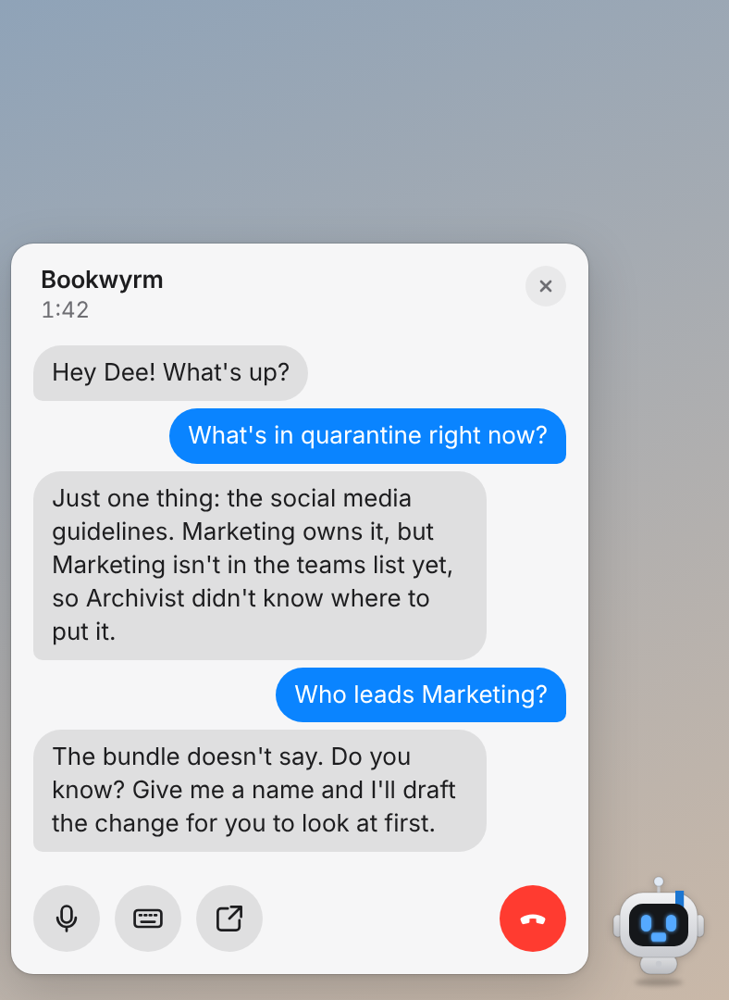
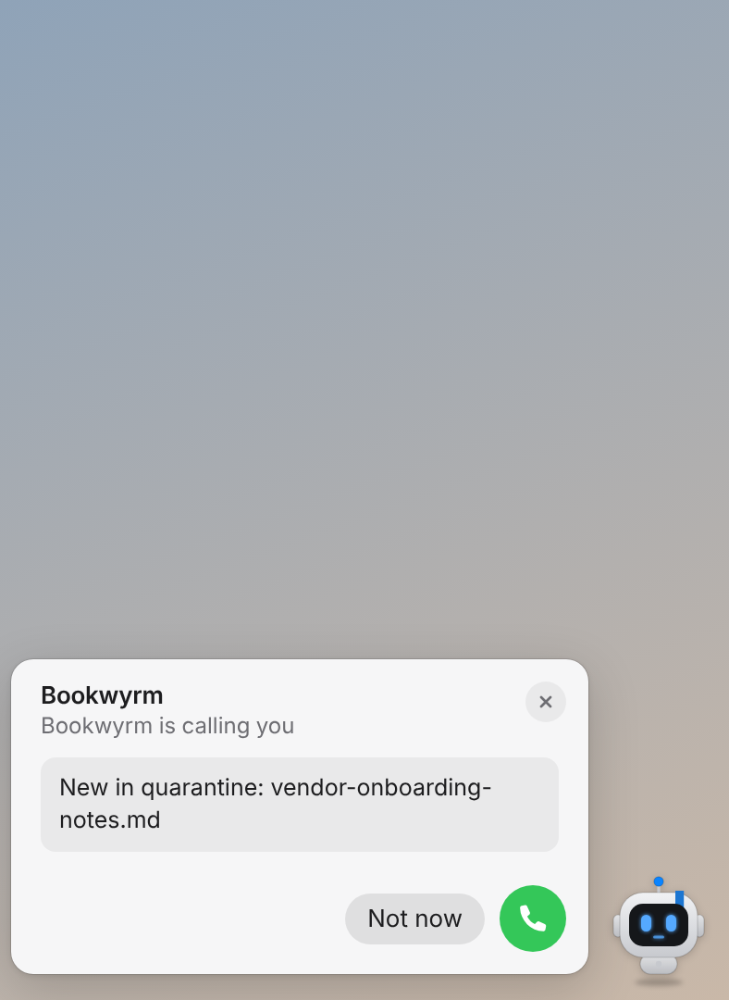
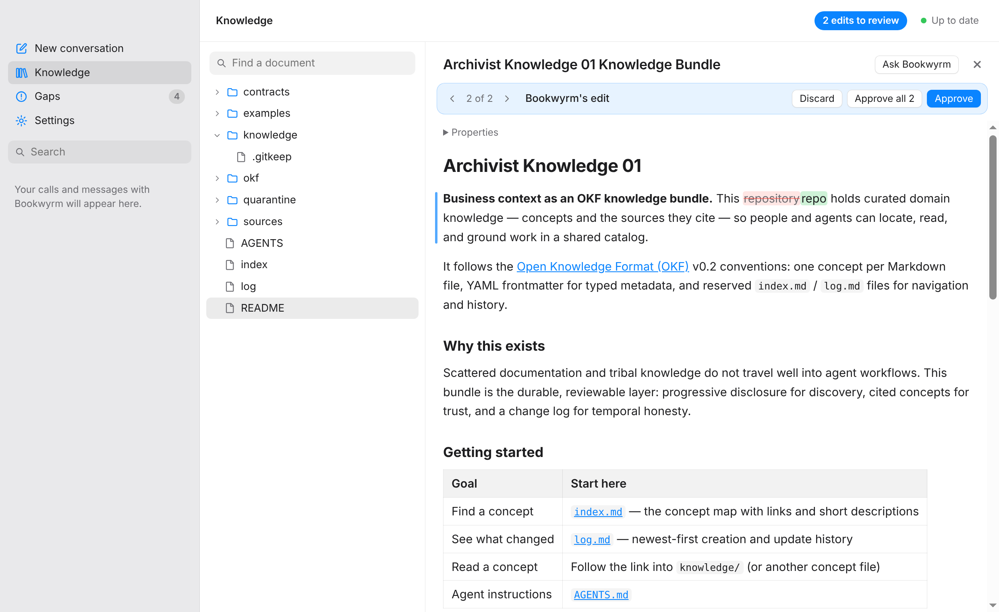
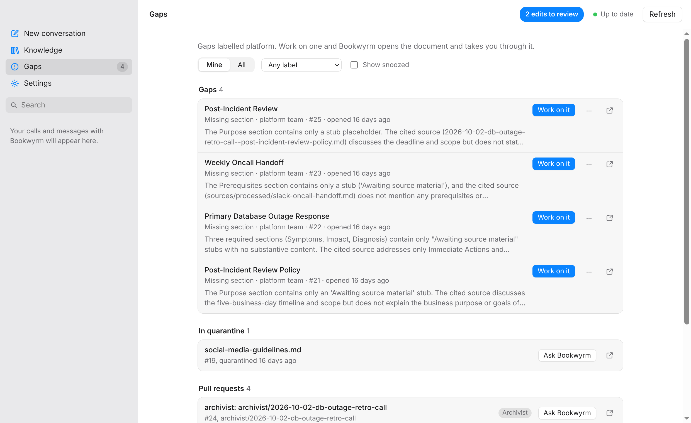

# Bookwyrm

The librarian for [Archivist](https://github.com/dfirmin/archivist) knowledge repos.

Archivist turns messy documents into a curated knowledge bundle in a git repo. Bookwyrm is the
assistant the people who own that bundle talk to — repo owners, SMEs and product owners — so they
can keep it right without ever opening GitHub. It answers questions, makes any change they ask for
(one word, a rewrite, a new document, or the same change across fifty documents), works through
gaps and quarantine with them, and remembers what it was told.

Archivist is for big batches it works through on its own. Bookwyrm is for everything a person
wants to do themselves, and it never gates them: it suggests (a contract when a pattern repeats, a
source note so Archivist can cite something) and then does what they choose. See
[ADR 0008](docs/adr/0008-full-authoring-preview-approval.md).

## What it does

| Ask | What Bookwyrm does |
|---|---|
| "What's our policy on X?" | Answers from `index.md` → the concept → its cited sources, and says when a gap is open |
| "That value is wrong, it's 90 days" | Edits the concept; you see the change highlighted in the preview and approve it |
| "Replace PHMS with KMS in everything under claims" | Finds every document, edits them all; you step through them one at a time, or approve all |
| "Add a Data Quality section to these four subject areas" | Writes them, and asks once whether a contract should make Archivist do the same |
| "Here's the answer to that gap" | Writes it into the concept and links the gap issue, which closes when the change merges |
| "What's stuck in quarantine?" | Explains `okfx_quarantine.needs`; fixes the contract and requeues, places it by hand, or drops it, as you choose |
| "Here's the transcript from today's call" | Drops it in `sources/inbox/` for Archivist's next run, or puts what matters straight into the concepts |

**Everything is approved by a person, in the app.** Bookwyrm edits a copy of the repo on your
computer, and each edit appears beside the conversation as the rendered document, with what changed
highlighted. Approve it (or approve all) and Bookwyrm opens the pull request and merges it for you,
closing any gap it resolves. Concepts you approve carry a `verified` stamp with your name, so
Archivist knows a person stood behind them.

**Call it, or message it.** A small robot sits at the edge of your screen, quietly, in your
system's colours. Drag it wherever it's out of the way. Click it for a menu: **Call Bookwyrm**
and it rings, picks up and talks, in a natural voice with live captions, and you can cut in
whenever you like. **Send a message** to type instead. It can also call *you* when something new
lands in quarantine or a new gap is filed (off unless you switch it on). Speech is heard and
spoken on your machine; only text goes to the model. See [ADR 0003](docs/adr/0003-voice-companion.md)
and [ADR 0004](docs/adr/0004-companion-v2-window-installer.md).

<p>
  
  
  
</p>

**Open Bookwyrm** for the full window: every call and conversation (pick one up again by text
or by voice) with the document you're working on beside it; **Knowledge**, the repo's documents
to browse, read rendered and edit yourself; **Gaps**, yours first (by the labels you choose), each
with *Work on it*, plus quarantine and open pull requests; and **Settings** (your name and team, the
repo, keys, voice, calls, gap labels, open at login). The robot shows how many of your gaps are
open. Quit any time from the robot's menu or the menu-bar / tray icon.

<p>
  
  
</p>

Not yet: the Teams bot, a meeting bot, Postgres memory, and dispatching Archivist runs. Each can
attach later without changing the core (see
[ADR 0001](docs/adr/0001-hermes-runtime-github-tools-sqlite-memory.md)).

## How it's built

- **Runtime:** [Hermes Agent](https://github.com/NousResearch/hermes-agent), as a Hermes
  *profile* named `bookwyrm`. Model-agnostic: direct Anthropic, or any OpenAI-compatible
  endpoint such as a LiteLLM gateway.
- **Tools:** Bookwyrm's own workspace server (`voice/bookwyrm_voice/workspace_mcp.py`: list, read,
  search, write, edit, move and delete in a local copy of the repo, each edit going to the
  person's preview), and the [GitHub MCP server](https://github.com/github/github-mcp-server) for
  issues and reading pull requests. The agent has no way to publish: approving in the app does
  that. No terminal, no other file access, no web.
- **The workspace:** the app's local service keeps the copy in sync over GitHub's REST API (no git
  needed), holds each conversation's unpublished changes, merges other people's edits three ways,
  and publishes an approved change as one pull request, merged.
- **Behaviour:** `profile/SOUL.md` (who Bookwyrm is and its one principle) and the skills in
  `skills/` (one per job above). Shipped skills are read-only to the agent; skills it learns
  on its own land in the profile and are promoted here by pull request.
- **Memory:** Hermes' built-in memory and SQLite session store, per profile.

## Setup

Before you start, have two things ready:

- **An Anthropic API key** ([console.anthropic.com](https://console.anthropic.com/settings/keys)).
- **A fine-grained GitHub token** ([make one](https://github.com/settings/personal-access-tokens/new))
  that can reach *only* the knowledge repo, with Contents, Issues and Pull requests set to
  read and write. The token is the real fence on what Bookwyrm can touch.

Then run one line. **macOS or Linux** (Terminal):

```bash
curl -fsSL https://raw.githubusercontent.com/dfirmin/bookwyrm/main/install.sh | bash
```

**Windows 10/11** (PowerShell):

```powershell
irm https://raw.githubusercontent.com/dfirmin/bookwyrm/main/install.ps1 | iex
```

A setup wizard asks for your name, team and the two keys (it checks them as you go), then lets
you pick the knowledge repo from **Archivist's registry** (`targets.yaml` in the Archivist repo):
only active targets are offered, and Bookwyrm confirms the repo carries Archivist's
`contracts/target.yaml` before using it, so it can't be pointed at an arbitrary repo by mistake
(see [ADR 0006](docs/adr/0006-knowledge-repo-from-the-registry.md)). Then it installs everything with a checklist: Hermes Agent, the GitHub MCP server, the
`bookwyrm` Hermes profile, Hermes' local API, the voice service and its speech models (about
1 GB, once), the most natural voice your computer can run (Chatterbox on Apple Silicon Macs,
NVIDIA GPUs and fast CPUs, 1 to 3 GB more; otherwise the standard voice, see
[ADR 0007](docs/adr/0007-natural-voice-tiers.md)), and the companion app, which it adds to Applications / the Start menu / your app
menu. It fetches Node.js 22 for itself if you don't have it, and keeps Bookwyrm in `~/bookwyrm`
(`BOOKWYRM_DIR` to change). Your settings go to `~/.bookwyrm/settings.json`; the keys only to the
profile's own `.env`.

Run the same line again any time, for example after an update: it skips what's done. From a
clone, `./install.sh` (or `.\install.ps1`) does the same with that clone.

For scripts and CI:

```bash
ANTHROPIC_API_KEY=... GITHUB_PERSONAL_ACCESS_TOKEN=... \
  ./install.sh --yes --name "Dee Firmin" --team "Data Engineering" --repo dfirmin/archivist-knowledge-01
./install.sh --yes --only voice,models,app,launcher     # just some steps
./install.sh --dry-run                                  # show what it would do
./install.sh --only natural-voice --voice-engine kokoro # keep the standard voice (no extra download)
```

To compare the voices on your machine (speed, memory, and a WAV of each to listen to):
`voice/.venv/bin/python voice/tests/bench_voices.py`. To have Bookwyrm speak in a voice of your
choosing, put a 5 to 15 second recording in `~/.bookwyrm/voices/` and pick it in Settings.

`./install.sh --help` lists every option and step. One more thing to do yourself: **protect the
knowledge repo's `main`** (require a pull request before merging). Bookwyrm's rules say it only
works through PRs; branch protection is what makes that true.

**Using Bookwyrm.** Open it like any app (Applications, the Start menu, or your app menu), then
click the robot. [docs/setup.md](docs/setup.md) walks through it, with what to do if something's
off. Bookwyrm also works in a terminal: `hermes -p bookwyrm chat`.

**Anthropic directly, or your company's gateway.** Setup asks how Bookwyrm should reach
Claude: with an Anthropic API key, or through a LiteLLM (or other OpenAI-compatible) gateway,
given its address, the model name it uses for Claude, and your key. It checks the gateway before
using it: the key works, the model exists, and it streams and calls tools, which Bookwyrm needs.
Switch any time in the app under Settings → Model, or with
`./install.sh --provider gateway --gateway-url https://… --gateway-model claude-sonnet` (key in
`LITELLM_API_KEY`). The choice is kept in `~/.bookwyrm/settings.json`, so updates keep it. See
[ADR 0005](docs/adr/0005-company-gateway.md).

## Layout

```
profile/                 Hermes profile template: config.yaml, SOUL.md, .env.example
skills/                  Bookwyrm's skills (loaded read-only via skills.external_dirs)
voice/                   The app's local service: calls (Pipecat, local speech models), the Hermes
                         adapter, and the workspace (repo copy, changes, publishing; workspace*.py)
voice/prompts/           How Bookwyrm talks on a call
app/                     The desktop app (Electron): the robot, its call card, the Bookwyrm window
install.sh, install.ps1  One-line installers: get Node.js and the source, start the wizard
setup/                   The setup wizard (Ink): every install step, safe to re-run
docs/setup.md            Installing, using, troubleshooting, removing
docs/adr/                Decisions
.github/workflows/       CI: install and test on macOS, Windows and Linux
docs/live-proof/         What was run and what it showed
```
